**← [Все проекты · All projects](https://github.com/rukazax?tab=repositories)**

<div align="center">
  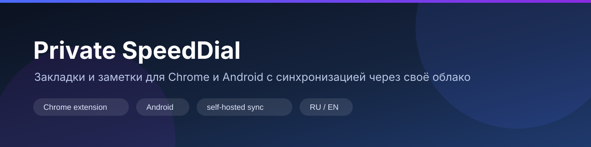
</div>

# Private SpeedDial

**RU** · [English](#english)

[](https://github.com/rukazax)
[](https://github.com/rukazax/Private_SpeedDial/releases/latest)
[](https://github.com/rukazax/Private_SpeedDial/releases/latest)
[](https://chromewebstore.google.com/detail/private-speeddial/eakakaeklcgnlanmpbndhjdljppehdof)
[](https://github.com/rukazax/Private_SpeedDial/releases/latest/download/Private-SpeedDial-Android.apk)

> **Закладки и заметки для Chrome и Android** — с папками, профилями и синхронизацией через ваше собственное облако (WebDAV/Nextcloud). Без центрального сервера проекта и регистрации: данные остаются у вас.

[**Скачать APK для Android**](https://github.com/rukazax/Private_SpeedDial/releases/latest/download/Private-SpeedDial-Android.apk) · [**Установить расширение Chrome**](https://chromewebstore.google.com/detail/private-speeddial/eakakaeklcgnlanmpbndhjdljppehdof) · [Все релизы](https://github.com/rukazax/Private_SpeedDial/releases)

| Раздел | О чём |
|---|---|
| ⚡ [Установка за несколько минут](#установка-за-несколько-минут) | APK для Android и расширение для Chrome |
| ✨ [Возможности](#возможности) | сравнение расширения и Android-приложения |
| 🖼 [Как это выглядит](#как-это-выглядит) | скриншоты обеих версий |
| 🔐 [Принципы работы](#принципы-работы) | локальное хранение, шифрование, синхронизация |
| 🔄 [Обновления](#обновления) | как приложение и расширение проверяют релизы |
| 📚 [Документация и разработка](#документация-и-разработка) | гайды, архитектура, сборка, приватность |
| 💬 [Обратная связь](#обратная-связь) | как сообщить об ошибке |

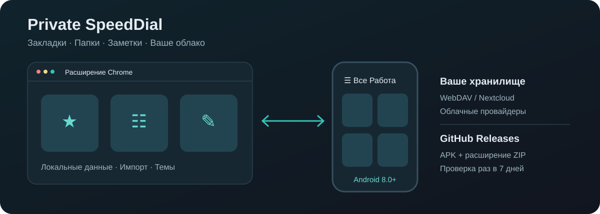

Private SpeedDial — панель быстрого доступа к сайтам с папками, заметками, профилями, темами, фонами и импортом закладок. В этом репозитории находятся исходники расширения Manifest V3, адаптированного приложения Android, общие модули распространения и обновлений, сценарии сборки и проверки.

Автор приложения — **Константин Ерёмин**. Интерфейс поддерживает 13 языков: русский, английский, немецкий, испанский, французский, итальянский, португальский, китайский, японский, корейский, турецкий, хинди и арабский.

## Установка за несколько минут

### Android

1. [Скачайте APK](https://github.com/rukazax/Private_SpeedDial/releases/latest/download/Private-SpeedDial-Android.apk) на телефон с Android 8.0 или новее.
2. Откройте файл. При запросе Android разрешите установку из этого источника для браузера или файлового менеджера.
3. Установите приложение и откройте Private SpeedDial. Чтобы добавить сайт, нажмите **☰ → Добавить закладку**. Для заметки: **☰ → Заметки → + Заметка**.
4. При обновлении устанавливайте новый APK поверх старого. Не удаляйте приложение: удаление стирает локальные данные. Официальный APK подписан прежним ключом проекта.

### Chrome и другие совместимые браузеры

1. Откройте [Private SpeedDial в Chrome Web Store](https://chromewebstore.google.com/detail/private-speeddial/eakakaeklcgnlanmpbndhjdljppehdof) на компьютере и нажмите **«Установить» / «Добавить в Chrome»**.
2. Подтвердите разрешения браузера, закрепите значок Private SpeedDial на панели и откройте его → **Открыть Private SpeedDial**. Также доступно `Ctrl+Shift+Y` (`Command+Shift+Y` на macOS).
3. В Android откройте **☰ → Установить расширение для браузера** — откроется эта же страница магазина. Для установки расширения используйте совместимый настольный браузер.

Альтернатива для ручной установки: [скачать ZIP из GitHub Releases](https://github.com/rukazax/Private_SpeedDial/releases/latest/download/Private-SpeedDial-Extension.zip), распаковать, открыть `chrome://extensions`, включить режим разработчика и выбрать папку с `manifest.json` через «Загрузить распакованное расширение».

Версии в Chrome Web Store и GitHub могут отличаться: публикация обновления в магазине выполняется отдельно. Магазинную версию обновляет браузер; ZIP из GitHub устанавливается и обновляется вручную. Расширение из этого репозитория не заменяет новую вкладку автоматически.

Полные инструкции, обновление без потери данных и решение проблем: **[Установка и использование](docs/USER-GUIDE.md)**.

## Возможности

| Возможность | Расширение браузера | Android |
|---|---|---|
| Закладки, вложенные папки, заметки и папки заметок | Да | Да |
| Две строки папок: сверху группы, ниже закреплённые подпапки открытой папки | Да | Одна строка |
| Фон плитки — снимок сайта: поштучно, по папке, для выделенных | Да | Нет |
| Массовые операции: выделение, перемещение, цвет, удаление | Да | Нет |
| Уборка: дубли по адресу, мусорные заголовки, пустые папки, битые имена | Да | Нет |
| Полная резервная копия и восстановление JSON | Да | Системный выбор файла |
| Профили, темы, цвета, фоны | Да | Да |
| Ручная и автоматическая синхронизация | Да | Пока приложение открыто |
| Пароли отдельных папок | Да | Да |
| Импорт JSON / HTML / CSV / FVD, экспорт JSON / HTML | Да | Системный выбор и сохранение файла |
| Поиск в закладках и заметках | Да | В меню ☰ |
| Интернет-поиск, курсы валют, настольная верхняя панель | Настольный интерфейс сохранён | Удалены |
| Мастер-пароль, автоблокировка, «Не беспокоить» | Настольные функции сохранены | Удалены |
| Поделиться приложением через GitHub | Кнопка в настройках; Web Share или копирование | Системное меню Android |
| Проверка релизов GitHub | Нет; магазин обновляет браузер, ZIP — вручную | При открытии приложения, максимум раз в 7 дней |

На Android папки находятся справа от ☰ в одной горизонтально прокручиваемой строке. На основном экране телефона — два столбца плиток. На широком внутреннем экране добавляются столбцы, размер плиток сохраняется по ориентиру основного экрана. Заголовок выдвижного меню закреплён при прокрутке. Крестик в форме заметки сохраняет её и закрывает форму; при ошибке записи текст остаётся в форме.

## Как это выглядит

| Android: главный экран | Android: меню и заметки | Android: настройки |
|---|---|---|
|  | 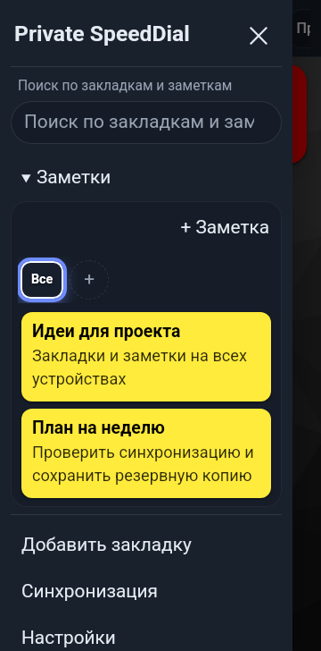 | 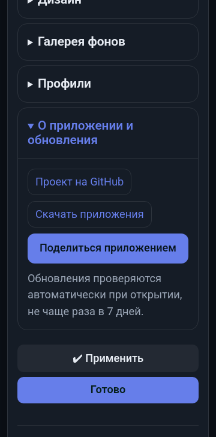 |

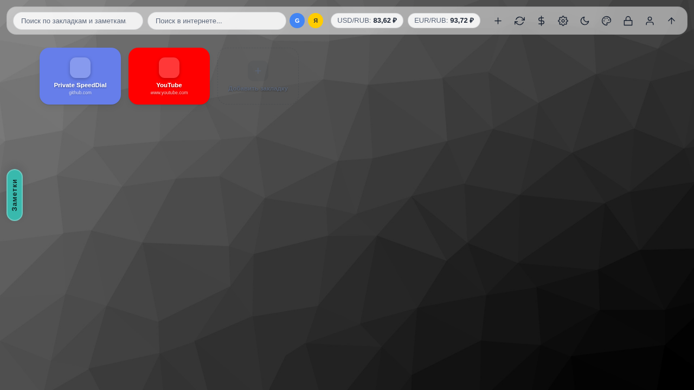

Две строки папок: сверху только группы, под ними — закреплённые подпапки открытой папки. При прокрутке обе строки остаются на месте.

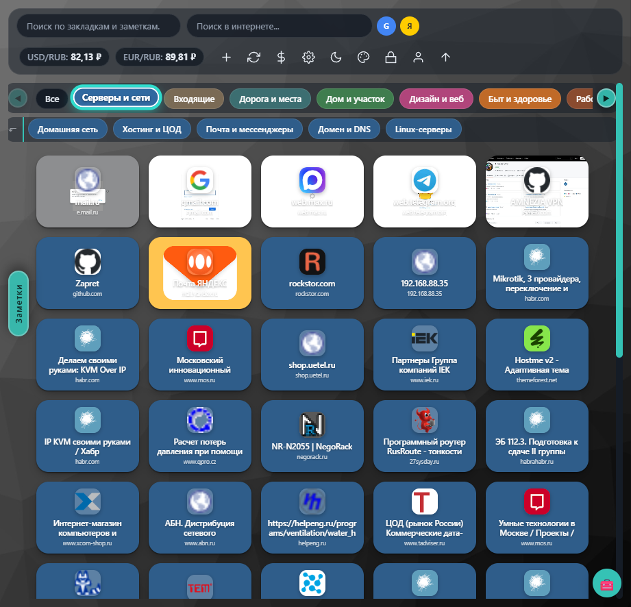

| Фон плитки — снимок сайта | Панель инструментов |
|---|---|
| 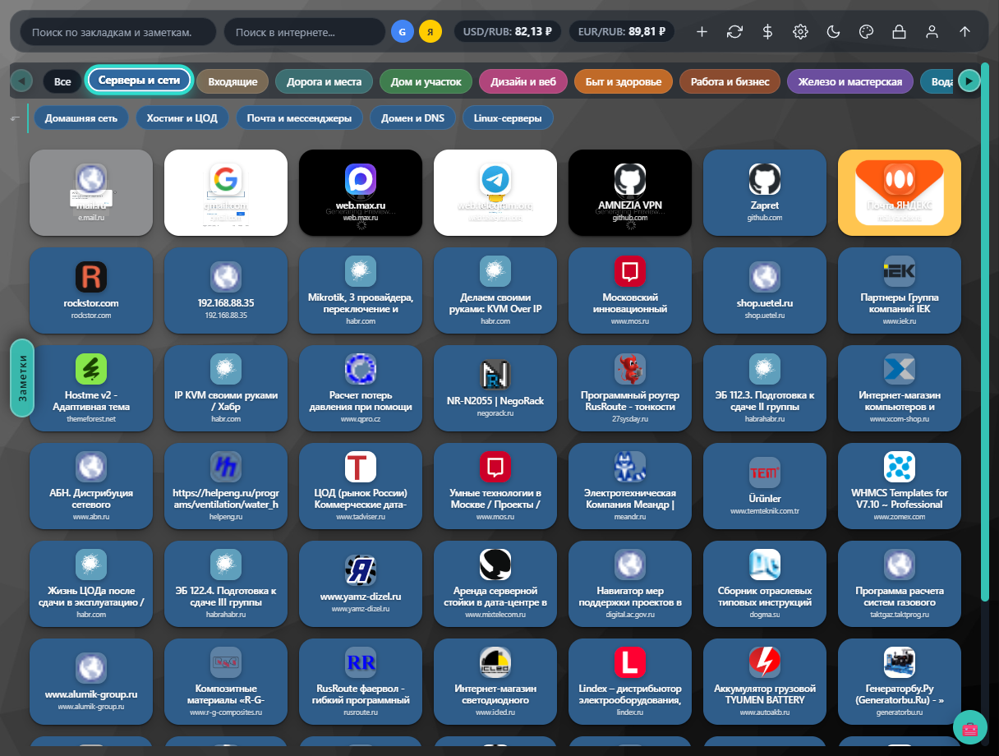 | 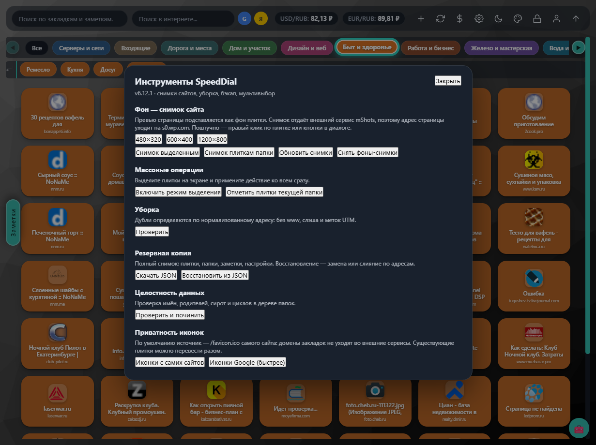 |

Скриншоты сделаны на тестовых данных в эмуляторе Android и отдельном профиле Chromium. Данные пользователя в репозиторий не включены. Новое окно первого запуска расширения проверено в отдельном профиле Chromium:

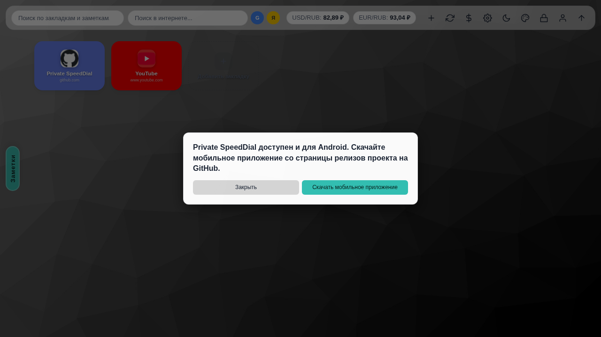

## Принципы работы

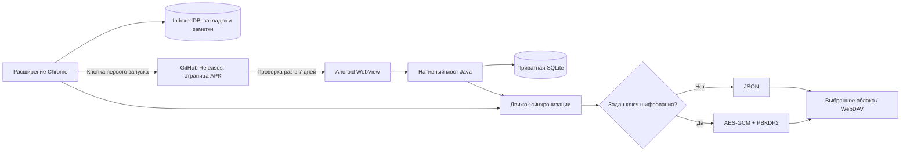

Данные сначала сохраняются локально. Для синхронизации вы самостоятельно настраиваете WebDAV/Nextcloud либо поддерживаемый облачный сервис. Обязательного центрального сервера проекта и регистрации в нём нет. Файл синхронизации называется `private-speeddial.json`; реквизиты подключения и ключ шифрования в него не включаются. Поддерживаются объединение, загрузка на сервер и скачивание с сервера. Есть учёт времени изменений и удалений, история и обработка первоначального конфликта.

**Приватность не означает отсутствие сети.** Выбранный облачный провайдер, сервис иконок, загружаемые по URL фоны и GitHub могут получать сетевые метаданные соответствующих запросов. В настольной версии также сохранены дополнительные сетевые функции. Локальная база не зашифрована самим приложением; пароль папки не заменяет защиту устройства. Подробности: [приватность и безопасность](docs/SECURITY.md).

## Обновления

Расширение не проверяет релизы GitHub. При первом открытии один раз появляется окно с кнопкой **«Скачать мобильное приложение»**, ведущей на [страницу APK в GitHub](https://github.com/rukazax/Private_SpeedDial/releases/latest). Закрытие окна тоже запоминается в локальном профиле; после обновления расширения оно не повторяется. Chrome обновляет магазинный выпуск самостоятельно; ZIP обновляется вручную.

Только Android-приложение запрашивает [последний стабильный релиз](https://github.com/rukazax/Private_SpeedDial/releases/latest) через публичный GitHub API. Дата попытки сохраняется **до запроса**; ошибки, отсутствие релизов и перезапуск не обходят недельный интервал. Предрелизы и черновики не предлагаются. Проверяются номер версии, адрес репозитория и наличие APK.

При наличии новой версии появляется окно **«Обновиться» / «Пропустить релиз»**. Первая кнопка открывает загрузку APK. Вторая запоминает именно этот релиз на этом устройстве; следующий более новый релиз может быть предложен. В пределах одного сеанса одно предложение не повторяется в нескольких окнах. Установка выполняется пользователем; автоматической установки кода нет.

[Подробности алгоритма и инструкция выпуска](docs/UPDATES.md).

## Документация и разработка

- [Установка, закладки, заметки, профили, перенос данных](docs/USER-GUIDE.md)
- [Настройка синхронизации и ограничения провайдеров](docs/SYNC.md)
- [Архитектура, структура исходников и потоки данных](docs/ARCHITECTURE.md)
- [Сборка APK, расширения и запуск тестов](docs/BUILD.md)
- [Обновления, релизы и стабильные ссылки загрузки](docs/UPDATES.md)
- [Приватность, подпись APK и сообщение об ошибке безопасности](docs/SECURITY.md)
- [Результаты проверки версии 6.12.1](docs/VERIFICATION.md) · [сводка в JSON](docs/verification-6.12.1.json)
- [Что нового в 6.12.1](docs/RELEASE-6.12.1.md)
- [Зависимости и их лицензии](THIRD_PARTY.md)
- [История изменений](CHANGELOG.md)

```text
extension/       самостоятельное расширение Chrome Manifest V3
android-app/     Android Manifest, Java, WebView-мост, мобильные стили и web/
shared/          единые настройки проекта, переводы, обновления и кнопка «Поделиться»
tools/           синхронизация общих файлов и подготовка ZIP релиза
tests/           изолированные проверки обновлений и Chromium
verification/    сценарии Android и тестовые облачные провайдеры
docs/            инструкции, схемы, скриншоты и отчёт о проверках
```

Публичность исходников не означает прохождение независимого аудита безопасности. Проверки на эмуляторе и тестовых серверах не подтверждают работу на каждой модели телефона или с реальными аккаунтами всех облачных сервисов. Физический Honor Magic V3 в этой проверке не участвовал.

## Обратная связь

[Сообщить об ошибке или предложить изменение](https://github.com/rukazax/Private_SpeedDial/issues). Укажите версию, платформу и шаги воспроизведения. Не прикладывайте пароли, токены, ключи, личные заметки или полный экспорт данных.

---

## English

> **Bookmarks and notes for Chrome and Android** — with folders, profiles and sync through your own cloud (WebDAV/Nextcloud). No project-owned central server and no registration: your data stays with you.

Private SpeedDial is a quick-access panel for sites with folders, notes, profiles, themes, backgrounds and bookmark import. This repository contains the sources of the Manifest V3 extension, the adapted Android app, shared distribution and update modules, and build and verification scripts.

The app author is **Konstantin Yeryomin**. The interface supports 13 languages: Russian, English, German, Spanish, French, Italian, Portuguese, Chinese, Japanese, Korean, Turkish, Hindi and Arabic.

[**Download the Android APK**](https://github.com/rukazax/Private_SpeedDial/releases/latest/download/Private-SpeedDial-Android.apk) · [**Install the Chrome extension**](https://chromewebstore.google.com/detail/private-speeddial/eakakaeklcgnlanmpbndhjdljppehdof) · [All releases](https://github.com/rukazax/Private_SpeedDial/releases)

### Install in minutes

#### Android

1. [Download the APK](https://github.com/rukazax/Private_SpeedDial/releases/latest/download/Private-SpeedDial-Android.apk) to a phone running Android 8.0 or newer.
2. Open the file. When Android asks, allow installation from this source for your browser or file manager.
3. Install the app and open Private SpeedDial. To add a site, tap **☰ → Add bookmark**. For a note: **☰ → Notes → + Note**.
4. When updating, install the new APK over the old one. Do not uninstall the app: uninstalling wipes local data. The official APK is signed with the project's original key.

#### Chrome and other compatible browsers

1. Open [Private SpeedDial in the Chrome Web Store](https://chromewebstore.google.com/detail/private-speeddial/eakakaeklcgnlanmpbndhjdljppehdof) on a computer and click **“Install” / “Add to Chrome”**.
2. Confirm the browser permissions, pin the Private SpeedDial icon to the toolbar and open it → **Open Private SpeedDial**. `Ctrl+Shift+Y` (`Command+Shift+Y` on macOS) also works.
3. On Android, open **☰ → Install browser extension** — the same store page opens. Use a compatible desktop browser to install the extension.

An alternative for manual installation: [download the ZIP from GitHub Releases](https://github.com/rukazax/Private_SpeedDial/releases/latest/download/Private-SpeedDial-Extension.zip), unpack it, open `chrome://extensions`, enable developer mode and pick the folder with `manifest.json` via “Load unpacked”.

Versions in the Chrome Web Store and on GitHub may differ: publishing an update to the store is a separate step. The browser updates the store version; the GitHub ZIP is installed and updated manually. The extension from this repository does not replace the new tab page automatically.

Full instructions, updating without data loss and troubleshooting: **[Installation and usage](docs/USER-GUIDE.md)**.

### Features

| Feature | Browser extension | Android |
|---|---|---|
| Bookmarks, nested folders, notes and note folders | Yes | Yes |
| Two folder rows: groups on top, the open folder's subfolders pinned below | Yes | Single row |
| Tile background from a site screenshot: per tile, per folder, for a selection | Yes | No |
| Bulk operations: select, move, recolor, delete | Yes | No |
| Cleanup: duplicate URLs, junk titles, empty folders, broken names | Yes | No |
| Full JSON backup and restore | Yes | System file picker |
| Profiles, themes, colors, backgrounds | Yes | Yes |
| Manual and automatic sync | Yes | While the app is open |
| Passwords for individual folders | Yes | Yes |
| Import JSON / HTML / CSV / FVD, export JSON / HTML | Yes | System file picker and saving |
| Search in bookmarks and notes | Yes | In the ☰ menu |
| Web search, currency rates, desktop top bar | Desktop UI preserved | Removed |
| Master password, auto-lock, “Do not disturb” | Desktop features preserved | Removed |
| Share the app via GitHub | Button in settings; Web Share or copy | Android system menu |
| GitHub release check | None; the store updates via the browser, ZIP — manually | On app open, at most once per 7 days |

On Android, folders sit to the right of ☰ in a single horizontally scrollable row. The main phone screen shows two columns of tiles. On a wide inner screen more columns appear, and tile size follows the orientation of the main screen. The drawer header stays pinned while scrolling. The cross-shaped note button saves the note and closes the form; if saving fails, the text stays in the form.

### What it looks like

| Android: main screen | Android: menu and notes | Android: settings |
|---|---|---|
|  |  |  |


Two folder rows: groups on top, the open folder's subfolders pinned underneath. Both rows stay in place while the tiles scroll.


| Tile background from a site screenshot | Tools panel |
|---|---|
|  |  |

Screenshots were taken on test data in an Android emulator and a separate Chromium profile. No user data is included in the repository. The extension's first-launch window was verified in a separate Chromium profile:


### How it works

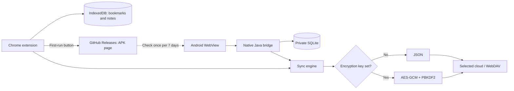

Data is saved locally first. For synchronization you configure WebDAV/Nextcloud or a supported cloud service yourself. There is no mandatory project-owned central server and no registration there. The sync file is called `private-speeddial.json`; connection credentials and the encryption key are never included in it. Merging, uploading to the server and downloading from the server are supported, along with change and deletion timestamps, history and initial-conflict handling.

**Privacy does not mean no network.** The cloud provider you choose, the icon service, backgrounds loaded by URL and GitHub may receive network metadata of the corresponding requests. The desktop version also keeps additional network features. The local database is not encrypted by the app itself; a folder password does not replace device security. Details: [privacy and security](docs/SECURITY.md).

### Updates

The extension does not check GitHub releases. On first open, a one-time window appears with a **“Download the mobile app”** button leading to [the APK page on GitHub](https://github.com/rukazax/Private_SpeedDial/releases/latest). Closing the window is also remembered in the local profile; it does not reappear after an extension update. Chrome updates the store build on its own; the ZIP is updated manually.

Only the Android app queries [the latest stable release](https://github.com/rukazax/Private_SpeedDial/releases/latest) through the public GitHub API. The attempt date is saved **before the request**; errors, missing releases and restarts do not bypass the weekly interval. Pre-releases and drafts are never offered. The version number, repository address and APK availability are checked.

When a new version is available, an **“Update” / “Skip release”** window appears. The first button opens the APK download. The second remembers exactly this release on this device; a newer release may be offered later. Within a single session one offer is not repeated across multiple windows. Installation is performed by the user; there is no automatic code installation.

[Algorithm details and the release guide](docs/UPDATES.md).

### Documentation and development

- [Installation, bookmarks, notes, profiles, data migration](docs/USER-GUIDE.md)
- [Sync setup and provider limitations](docs/SYNC.md)
- [Architecture, source layout and data flows](docs/ARCHITECTURE.md)
- [Building the APK and extension, running tests](docs/BUILD.md)
- [Updates, releases and stable download links](docs/UPDATES.md)
- [Privacy, APK signature and the security disclosure](docs/SECURITY.md)
- [Verification results for version 6.12.1](docs/VERIFICATION.md) · [JSON summary](docs/verification-6.12.1.json)
- [What's new in 6.12.1](docs/RELEASE-6.12.1.md)
- [Dependencies and their licenses](THIRD_PARTY.md)
- [Changelog](CHANGELOG.md)

```text
extension/       self-contained Chrome Manifest V3 extension
android-app/     Android Manifest, Java, WebView bridge, mobile styles and web/
shared/          shared project settings, translations, updates and the “Share” button
tools/           syncing shared files and preparing the release ZIP
tests/           isolated update and Chromium checks
verification/    Android scenarios and test cloud providers
docs/            guides, diagrams, screenshots and the verification report
```

Public sources do not imply an independent security audit has taken place. Checks on an emulator and test servers do not confirm operation on every phone model or with real accounts of every cloud service. The physical Honor Magic V3 did not take part in this verification.

### Feedback

[Report a bug or suggest a change](https://github.com/rukazax/Private_SpeedDial/issues). Please include the version, platform and reproduction steps. Do not attach passwords, tokens, keys, personal notes or a full data export.

---

#chrome-extension #android #bookmarks #notes #webdav #nextcloud #sync #encryption #privacy #mv3 #webview #offline-first
