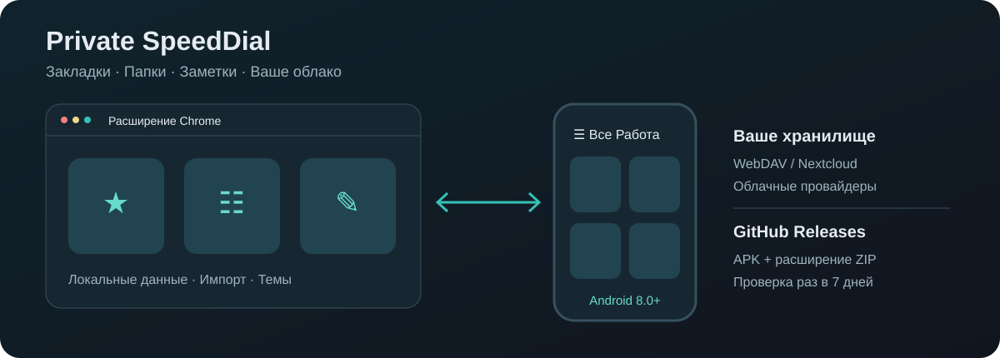
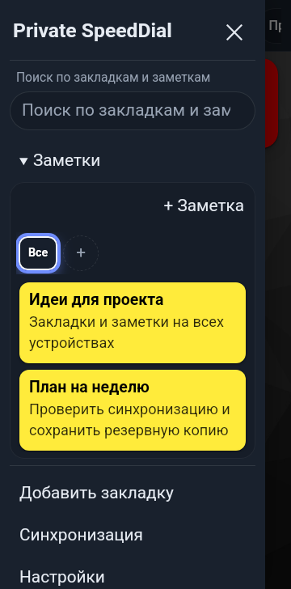
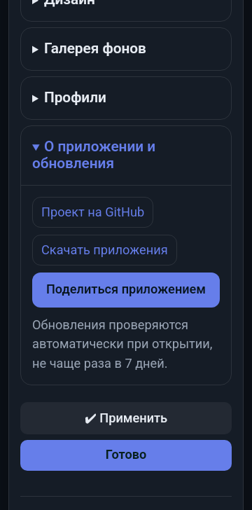
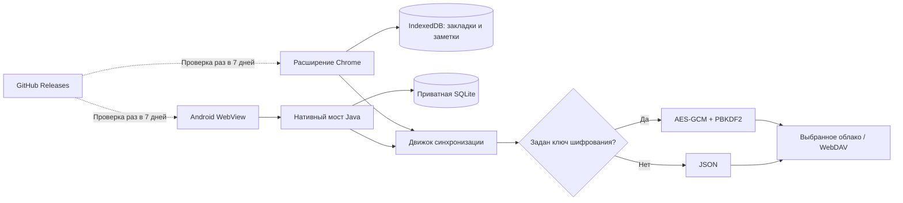

<div align="center">

# Private SpeedDial

**Ваши закладки и заметки — на ПК и Android, с синхронизацией в выбранное вами облако.**

[](https://github.com/rukazax/Private_SpeedDial/releases/latest)
[](https://github.com/rukazax/Private_SpeedDial/releases/latest/download/Private-SpeedDial-Android.apk)
[](https://chromewebstore.google.com/detail/private-speeddial/eakakaeklcgnlanmpbndhjdljppehdof)

[**Скачать APK для Android**](https://github.com/rukazax/Private_SpeedDial/releases/latest/download/Private-SpeedDial-Android.apk) · [**Установить расширение Chrome**](https://chromewebstore.google.com/detail/private-speeddial/eakakaeklcgnlanmpbndhjdljppehdof) · [Все релизы](https://github.com/rukazax/Private_SpeedDial/releases)



</div>

Private SpeedDial — панель быстрого доступа к сайтам с папками, заметками, профилями, темами, фонами и импортом закладок. В этом репозитории находятся исходники расширения Manifest V3, адаптированного приложения Android, общие модули распространения и обновлений, сценарии сборки и проверки.

Автор приложения — **Константин Ерёмин**. Интерфейс поддерживает 13 языков: русский, английский, немецкий, испанский, французский, итальянский, португальский, китайский, японский, корейский, турецкий, хинди и арабский.

## Установка за несколько минут

### Android

1. [Скачайте APK](https://github.com/rukazax/Private_SpeedDial/releases/latest/download/Private-SpeedDial-Android.apk) на телефон с Android 8.0 или новее.
2. Откройте файл. При запросе Android разрешите установку из этого источника для браузера или файлового менеджера.
3. Установите приложение и откройте Private SpeedDial. Чтобы добавить сайт, нажмите **☰ → Добавить закладку**. Для заметки: **☰ → Заметки → + Заметка**.
4. При обновлении устанавливайте новый APK поверх старого. Не удаляйте приложение: удаление стирает локальные данные. Официальный APK подписан прежним ключом проекта.

### Chrome и другие совместимые браузеры

1. Откройте [Private SpeedDial в Chrome Web Store](https://chromewebstore.google.com/detail/private-speeddial/eakakaeklcgnlanmpbndhjdljppehdof) на компьютере и нажмите **«Установить» / «Добавить в Chrome»**.
2. Подтвердите разрешения браузера, закрепите значок Private SpeedDial на панели и откройте его → **Открыть Private SpeedDial**. Также доступно `Ctrl+Shift+Y` (`Command+Shift+Y` на macOS).
3. В Android откройте **☰ → Установить расширение для браузера** — откроется эта же страница магазина. Для установки расширения используйте совместимый настольный браузер.

Альтернатива для ручной установки: [скачать ZIP из GitHub Releases](https://github.com/rukazax/Private_SpeedDial/releases/latest/download/Private-SpeedDial-Extension.zip), распаковать, открыть `chrome://extensions`, включить режим разработчика и выбрать папку с `manifest.json` через «Загрузить распакованное расширение».

Версии в Chrome Web Store и GitHub могут отличаться: публикация обновления в магазине выполняется отдельно. Магазинную версию обновляет браузер; ZIP из GitHub устанавливается и обновляется вручную. Расширение из этого репозитория не заменяет новую вкладку автоматически.

Полные инструкции, обновление без потери данных и решение проблем: **[Установка и использование](docs/USER-GUIDE.md)**.

## Возможности

| Возможность | Расширение браузера | Android |
|---|---|---|
| Закладки, вложенные папки, заметки и папки заметок | Да | Да |
| Профили, темы, цвета, фоны | Да | Да |
| Ручная и автоматическая синхронизация | Да | Пока приложение открыто |
| Пароли отдельных папок | Да | Да |
| Импорт JSON / HTML / CSV / FVD, экспорт JSON / HTML | Да | Системный выбор и сохранение файла |
| Поиск в закладках и заметках | Да | В меню ☰ |
| Интернет-поиск, курсы валют, настольная верхняя панель | Настольный интерфейс сохранён | Удалены |
| Мастер-пароль, автоблокировка, «Не беспокоить» | Настольные функции сохранены | Удалены |
| Поделиться приложением через GitHub | Кнопка в настройках; Web Share или копирование | Системное меню Android |
| Проверка релизов GitHub | При открытии интерфейса, максимум раз в 7 дней | При открытии приложения, максимум раз в 7 дней |

На Android папки находятся справа от ☰ в одной горизонтально прокручиваемой строке. На основном экране телефона — два столбца плиток. На широком внутреннем экране добавляются столбцы, размер плиток сохраняется по ориентиру основного экрана. Заголовок выдвижного меню закреплён при прокрутке. Крестик в форме заметки сохраняет её и закрывает форму; при ошибке записи текст остаётся в форме.

## Как это выглядит

| Android: главный экран | Android: меню и заметки | Android: настройки |
|---|---|---|
|  |  |  |


Скриншоты сделаны на тестовых данных в эмуляторе Android и отдельном профиле Chromium. Данные пользователя в репозиторий не включены. [Пример окна обновления](docs/images/update.png) использует **тестовый будущий релиз**, чтобы показать предложение обновиться.

## Принципы работы



Данные сначала сохраняются локально. Для синхронизации вы самостоятельно настраиваете WebDAV/Nextcloud либо поддерживаемый облачный сервис. Обязательного центрального сервера проекта и регистрации в нём нет. Файл синхронизации называется `private-speeddial.json`; реквизиты подключения и ключ шифрования в него не включаются. Поддерживаются объединение, загрузка на сервер и скачивание с сервера. Есть учёт времени изменений и удалений, история и обработка первоначального конфликта.

**Приватность не означает отсутствие сети.** Выбранный облачный провайдер, сервис иконок, загружаемые по URL фоны и GitHub могут получать сетевые метаданные соответствующих запросов. В настольной версии также сохранены дополнительные сетевые функции. Локальная база не зашифрована самим приложением; пароль папки не заменяет защиту устройства. Подробности: [приватность и безопасность](docs/SECURITY.md).

## Обновления

Приложения запрашивают [последний стабильный релиз](https://github.com/rukazax/Private_SpeedDial/releases/latest) через публичный GitHub API. Дата попытки сохраняется **до запроса**; ошибки, отсутствие релизов и перезапуск не обходят недельный интервал. Предрелизы и черновики не предлагаются. Проверяются номер версии, адрес репозитория и наличие нужного APK/ZIP.

При наличии новой версии появляется окно **«Обновиться» / «Пропустить релиз»**. Первая кнопка открывает загрузку соответствующего файла. Вторая запоминает именно этот релиз на этом устройстве; следующий более новый релиз может быть предложен. В пределах одного сеанса одно предложение не повторяется в нескольких окнах. Установка выполняется пользователем; автоматической установки кода нет.

[Подробности алгоритма и инструкция выпуска](docs/UPDATES.md).

## Документация и разработка

- [Установка, закладки, заметки, профили, перенос данных](docs/USER-GUIDE.md)
- [Настройка синхронизации и ограничения провайдеров](docs/SYNC.md)
- [Архитектура, структура исходников и потоки данных](docs/ARCHITECTURE.md)
- [Сборка APK, расширения и запуск тестов](docs/BUILD.md)
- [Обновления, релизы и стабильные ссылки загрузки](docs/UPDATES.md)
- [Приватность, подпись APK и сообщение об ошибке безопасности](docs/SECURITY.md)
- [Результаты проверки версии 6.10.2](docs/VERIFICATION.md)
- [Зависимости и их лицензии](THIRD_PARTY.md)
- [История изменений](CHANGELOG.md)

```text
extension/       самостоятельное расширение Chrome Manifest V3
android-app/     Android Manifest, Java, WebView-мост, мобильные стили и web/
shared/          единые настройки проекта, переводы, обновления и кнопка «Поделиться»
tools/           синхронизация общих файлов и подготовка ZIP релиза
tests/           изолированные проверки обновлений и Chromium
verification/    сценарии Android и тестовые облачные провайдеры
docs/            инструкции, схемы, скриншоты и отчёт о проверках
```

Публичность исходников не означает прохождение независимого аудита безопасности. Проверки на эмуляторе и тестовых серверах не подтверждают работу на каждой модели телефона или с реальными аккаунтами всех облачных сервисов. Физический Honor Magic V3 в этой проверке не участвовал.

## Обратная связь

[Сообщить об ошибке или предложить изменение](https://github.com/rukazax/Private_SpeedDial/issues). Укажите версию, платформу и шаги воспроизведения. Не прикладывайте пароли, токены, ключи, личные заметки или полный экспорт данных.
