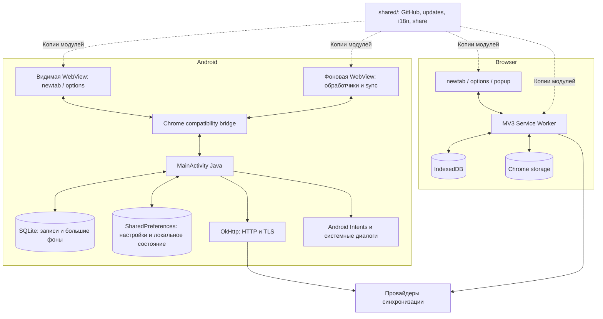

# Архитектура

## Два клиента и общий протокол

Расширение — обычное Chrome Manifest V3 приложение: фоновой точкой входа служит `extension/background.js`, интерфейсами — `newtab.html`, `options.html` и `popup.html`. Оно использует API Chrome, IndexedDB и адаптеры облачных сервисов.

Android — Activity на Java с двумя доверенными WebView: видимым интерфейсом и фоновым контекстом. `android-app/bridge.js` предоставляет совместимый слой Chrome API; `MainActivity.java` выполняет хранение, HTTP, открытие внешних ссылок, выбор файлов и системную отправку ссылки. Страницы загружаются из APK под защищённым локальным origin `https://appassets.androidplatform.net/`. Внешние сайты открываются отдельно и не получают нативный мост.

## Основные файлы

| Путь | Назначение |
|---|---|
| `extension/manifest.json` | Версия, разрешения, worker, popup, горячие клавиши |
| `extension/newtab.js`, `options.js` | Контроллеры закладок/заметок и настроек |
| `extension/background/sync.js` | Сборка payload, объединение, конфликты и режимы sync |
| `extension/background/providers/` | Реализации облачных API |
| `android-app/web/` | Мобильная ветка веб-интерфейса и движка |
| `android-app/layout.js`, `mobile.css`, `mobile.js` | Меню, папки, размеры плиток, мобильные действия |
| `android-app/storage.js` | SQLite-адаптер и чтение старого IndexedDB |
| `android-app/bridge.js` | Chrome API → нативный мост, session/local/sync, fetch |
| `android-app/src/su/econa/speeddial/MainActivity.java` | Activity, доверенные assets, SQLite, HTTP, Android UI |
| `shared/project.js` | Публичные URL, имена файлов, версия и недельный интервал |
| `shared/project-updates.js` | Проверка/валидация релиза, кеш, skip, session claim |
| `shared/project-ui.js` | Настройки проекта, кнопка share, предложение обновления |
| `shared/project-i18n.js` | Переводы новых функций для всех 13 языков |
| `tools/sync-shared.py` | Копирование общих модулей в два клиента / проверка совпадения |
| `android-app/build.py` | Подготовка assets, javac, D8, aapt2, zipalign, подпись |

## Сохранение и совместимость

Записи имеют ID и временные метки; удаления учитываются маркерами tombstones. Настройки интерфейса и профили используют существующий протокол проекта. Обновление 6.10.0 не меняет формат облачного файла. Ссылка старой встроенной плитки обновляется на GitHub только при совпадении её известного ID, старого заголовка и адреса; пользовательские закладки не удаляются.

При Android-сборке `web/` копируется в `assets/www`, добавляются мост и мобильные модули, фоновые importScripts объединяются в один JavaScript. Удаляются дубли фоновых файлов и ненужные ресурсы. Каталоги `assets/` и `build/` генерируются и не хранятся в Git.

Изменения в `shared/` нужно синхронизировать командой `python3 tools/sync-shared.py`. Копии намеренно включены в каждый клиент: расширение из папки `extension/` работает без отдельного этапа сборки. Проверка `--check` обнаруживает рассогласование.

## Ограничения

В мобильной ветке удалены настольные функции, поэтому её `web/` отличается от `extension/`. Эти каталоги нельзя бездумно заменять друг другом. Код синхронизации присутствует в обоих клиентах; изменения протокола требуют проверки обеих версий. Фоновая WebView Android живёт вместе с Activity и не заменяет системную службу.
