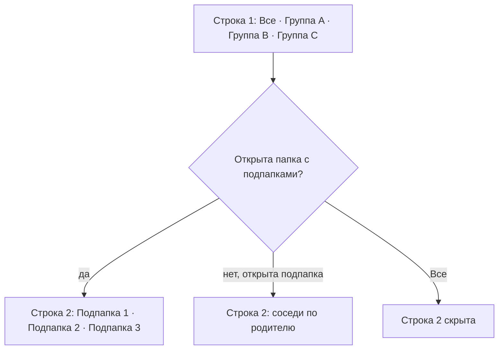

# Private SpeedDial 6.11.0 — что нового

Сборка из исходников: теги, уборка, бэкап, массовые операции, двухуровневая полоса папок.

## Полоса папок

Сверху — только папки верхнего уровня. Подпапки открытой папки показываются **второй зависимой
строкой** под списком; когда открыта подпапка, вторая строка показывает соседей по родителю,
чтобы не терять навигацию. На «Все» вторая строка скрыта. Вертикальное расположение
(`folderBarPosition: left/right`) сохраняет прежний вложенный список.

Обе строки подчиняются настройке «показывать папки»: если она выключена, второй строки тоже нет.

## Теги

- Редактор в диалоге плитки: добавить по Enter или запятой, убрать крестиком.
- Чипы на карточке (до трёх), клик по чипу включает фильтр `#тег`.
- Исправлено: сохранение плитки затирало теги пустым массивом `tags: []` — теперь теги
  переживают редактирование.

## Поиск

Поля: заголовок, адрес, теги, имя папки. Операторы:

| Оператор | Что ищет |
|---|---|
| `#тег` | по тегам |
| `папка:дизайн` / `folder:…` | по имени папки |
| `тип:магазин` / `type:…` | по типу ресурса |
| `сайт:github` | по адресу |

## Массовые операции

Режим выделения: клик по плитке отмечает её вместо открытия. Действия — переместить, добавить
теги, задать цвет, удалить. «Отметить плитки текущей папки» — в один клик.

## Уборка

- Дубли по нормализованному адресу: без `www.`, завершающего слэша и меток UTM.
- Мусорные заголовки (`Упс, Нет заголовка`, `503 Service…`, `Сервер не найден`) заменяются именем сайта.
- Пустые папки и повреждённые имена (`U+FFFD`) — удаление и починка.
- Отдельно: «Всё сразу».

## Резервная копия

Полный снимок в JSON (плитки, папки, заметки, теги, томбстоуны) и восстановление с выбором
«слить» или «заменить». Слияние сопоставляет плитки по нормализованному адресу и объединяет теги.

## Целостность данных

Санитайзер при старте: повреждённые имена папок, дубли `id`, потерянные родители, осиротевшие
плитки, циклы в дереве, нормализация тегов. Каждое исправление пишется в консоль.

## Приватность

- Источник иконок по умолчанию — сам сайт (`/favicon.ico`), домены закладок не уходят во внешние сервисы.
- В панели — перевод существующих плиток на локальные иконки или на Google, одним действием.

## Фон-снимок сайта

Превью страницы как фон плитки: кнопки в диалоге плитки (600×400 и 1200×800) и массово из панели.
Снимок отдаёт внешний сервис mShots, поэтому адрес страницы уходит на `s0.wp.com` — включение
осознанное и поштучное. Отдельная кнопка снимает такие фоны.

## Ограничения этой сборки

- Новые строки интерфейса пока на русском; перевод на 13 языков — следующий выпуск.
- Ключ шифрования облака по-прежнему хранится в `chrome.storage.sync` (перенос в локальное
  хранилище меняет сценарий нескольких устройств и требует отдельного решения).
- Автоподстановка заголовков по `og:title` и ограничение параллелизма загрузки иконок не вошли в выпуск.

## Установка

Магазинная копия проверяет содержимое по подписанным хешам, поэтому правка файлов на месте
отвергается — Edge переустанавливает расширение из магазина. Для этой сборки:

1. Запустить `SpeedDial-6.11.0.cmd` — откроется Edge с отдельным профилем и подключённым билдом.
2. Данные переносятся один раз: панель 🧰 → «Восстановить из JSON» (бэкап лежит в профиле)
   либо посевом из резервной копии.

После публикации 6.11.0 в Chrome Web Store обычное обновление сработает штатно.
