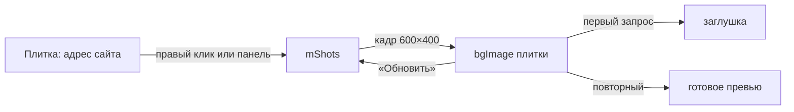

# Private SpeedDial 6.12.1 — что нового

## Что входит в выпуск

| Артефакт | Версия | Примечание |
|---|---|---|
| `Private-SpeedDial-Extension.zip` | 6.12.1 | распакованное расширение Manifest V3 |
| `SHA256SUMS.txt` | — | контрольные суммы загрузок |
| `browser-folders.png`, `browser-screenshot-bg.png`, `browser-tools.png` | — | скриншоты для описания релиза |

APK в этом выпуске не пересобирался: менялось только расширение. Ссылка на скачивание APK
по-прежнему ведёт на последнюю собранную сборку 6.10.3, исходники Android помечены 6.12.1 и будут
собраны в следующем выпуске APK.

## 6.12.1 — закреплённые подпапки

- Вторая строка папок закреплена при прокрутке: подпапки открытой папки остаются под первой строкой, плитки прокручиваются под ними. Смещение считается по фактической высоте верхней строки, для нижнего расположения панели — зеркально снизу.
- Исправлено исчезновение меню папок после перезагрузки: настройка «показывать папки» включена по умолчанию и сохраняется в `chrome.storage.sync` (раньше флаг жил только в памяти страницы).
- Панель инструментов оформлена в цветах темы: раньше текст наследовал цвет тёмной темы на светлом фоне и читался плохо.

## 6.12.0 — снимок сайта как фон, теги удалены

Фон плитки — снимок сайта. Теги удалены из расширения.

## Фон — снимок сайта

Плитка может показывать превью страницы, на которую ведёт. Четыре способа поставить:

| Где | Как |
|---|---|
| Правый клик по плитке | «🖼️ Фон — снимок сайта» |
| Диалог плитки | кнопки «📷 Снимок сайта 600×400», «1200×800», «↻ Обновить» |
| Режим выделения | кнопка «Снимок фоном» для всех отмеченных плиток |
| Панель 🧰 | «Снимок выделенным», «Снимок плиткам папки», «Обновить снимки», «Снять фоны-снимки» |

Размер по умолчанию выбирается в панели (480×320, 600×400, 1200×800). Повторный снимок у той же
плитки обновляет кадр: к адресу добавляется метка времени, чтобы сервис не отдал кеш.

**Про приватность и ожидание.** Снимок отдаёт внешний сервис mShots, поэтому адрес страницы уходит
на `s0.wp.com` — включение осознанное: поштучно по плитке или с подтверждением для папки. Первый
кадр сервис готовит несколько секунд, до этого на плитке видна заглушка; повторный запрос отдаёт
готовое превью.

Снять такие фоны можно разом: панель → «Снять фоны-снимки».

## Теги удалены

- Нет редактора тегов в диалоге плитки.
- Нет чипов на карточке и фильтра по клику.
- Поиск больше не ищет по тегам: остались заголовок, адрес, имя папки и тип ресурса.
- Поле `tags` в данных сохраняется пустым массивом ради совместимости схемы; остатки тегов
  вычищаются санитайзером при старте и при восстановлении из резервной копии.

## Поиск

| Оператор | Что ищет |
|---|---|
| `папка:дизайн` / `folder:…` | по имени папки |
| `тип:магазин` / `type:…` | по типу ресурса |
| `сайт:github` | по адресу |

Свободный текст ищет по заголовку, адресу и имени папки.

## Полоса папок — без изменений с 6.11

Сверху только папки верхнего уровня, подпапки открытой папки — второй зависимой строкой; при
открытии подпапки вторая строка показывает соседей по родителю; на «Все» скрыта. Обе строки
подчиняются настройке «показывать папки».

## Остальное из 6.11

Массовые операции (перемещение, цвет, удаление), «Уборка» (дубли по нормализованному адресу,
мусорные заголовки, пустые папки, повреждённые имена), полный бэкап JSON с восстановлением,
санитайзер данных при старте, иконки с самих сайтов по умолчанию.

## Установка

Магазинная копия проверяет содержимое по подписанным хешам, поэтому правка файлов на месте
отвергается — Edge переустанавливает расширение из магазина. Для этой сборки:

1. Запустить `SpeedDial-6.12.0.cmd` — откроется Edge с отдельным профилем `%LOCALAPPDATA%\SpeedDial-6.12`,
   где подключён этот билд, а сторонние расширения на время сессии отключены.
2. Данные переносятся один раз: панель 🧰 → «Восстановить из JSON» (бэкап лежит в профиле).

После публикации в Chrome Web Store обычное обновление сработает штатно.

## Ограничения

- Новые строки интерфейса пока на русском; перевод на 13 языков — следующий выпуск.
- Первый кадр снимка не мгновенный: его генерирует внешний сервис.
- Ключ шифрования облака по-прежнему в `chrome.storage.sync` (перенос меняет сценарий нескольких
  устройств и требует отдельного решения).