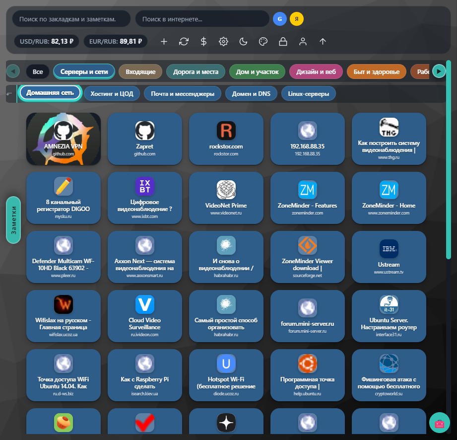
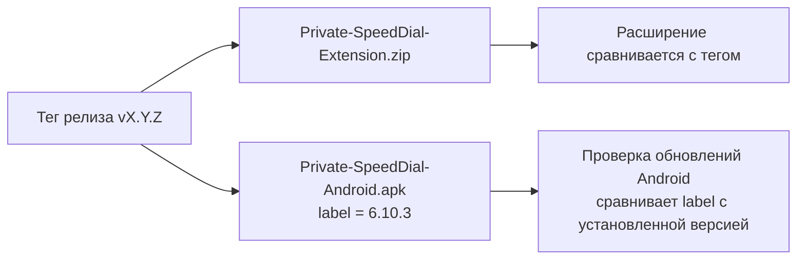

# Private SpeedDial 6.12.2 — что нового

## Что входит в выпуск

| Артефакт | Версия | Примечание |
|---|---|---|
| `Private-SpeedDial-Extension.zip` | 6.12.2 | распакованное расширение Manifest V3 |
| `Private-SpeedDial-Android.apk` | 6.10.3 | действующая сборка Android; метка файла равна этой версии |
| `SHA256SUMS.txt` | — | контрольные суммы загрузок |
| скриншоты | — | полоса папок, активная ветка, фон-снимок, панель |

APK в этом выпуске не пересобирался: менялось только расширение. Он приложен к релизу, чтобы
постоянная ссылка `releases/latest/download/Private-SpeedDial-Android.apk` продолжала работать, а
версия внутри файла указана в метке (`label`) и проверяется приложением.

## 6.12.2 — активная папка видна в верхней строке

- Если открыта подпапка, её корневая группа подсвечивается в верхней строке как **активная ветка**:
  видно, где вы находитесь, не только во второй строке.
- Активная папка или подпапка автоматически прокручивается в видимую область своей строки — это
  важно, когда групп или подпапок больше, чем влезает в экран.
- Обе строки по-прежнему закреплены при прокрутке и подчиняются настройке «показывать папки».

## 6.12.2 — независимое обновление APK

Версия опубликованного APK теперь берётся из **метки ассета**, а не из тега релиза:

Следствия:

- расширение и APK можно выпускать независимо;
- в релизе с новым расширением может лежать прежняя сборка APK — ссылка на скачивание не ломается;
- приложение не предлагает обновление на ту же версию, которую уже использует;
- если метки нет, работает прежнее сравнение по тегу.

Полные правила, при которых постоянные ссылки живут: [RELEASING.md](RELEASING.md).

## Установка

1. Скачать `Private-SpeedDial-Extension.zip`, распаковать.
2. Открыть `chrome://extensions`, включить режим разработчика, «Загрузить распакованное расширение»,
   выбрать папку с `manifest.json`.

Магазинная копия проверяет содержимое по подписанным хешам, поэтому правка файлов на месте
отвергается — для этой сборки используется распакованная установка. После публикации в Chrome Web
Store обычное обновление сработает штатно.

## Ограничения

- Новые строки интерфейса пока на русском; перевод на 13 языков — следующий выпуск.
- Первый кадр фона-снимка готовит внешний сервис mShots, до готовности видна заглушка.
- Ключ шифрования облака по-прежнему в `chrome.storage.sync` (перенос меняет сценарий нескольких
  устройств и требует отдельного решения).
