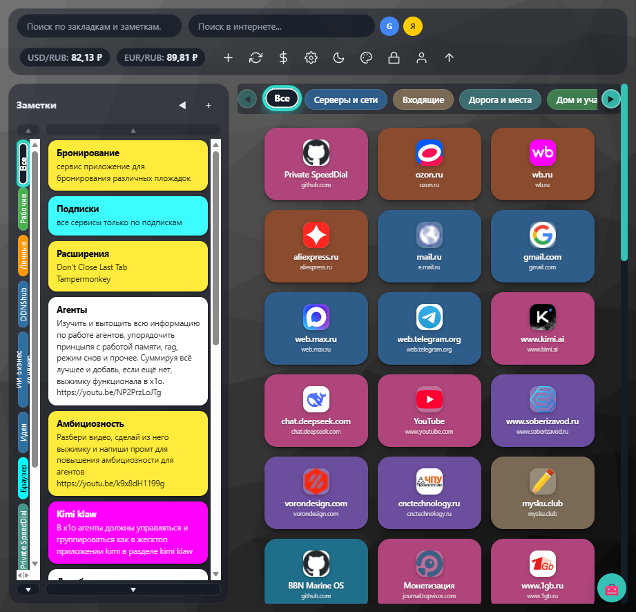

# Private SpeedDial 6.12.3 — что нового

## Что входит в выпуск

| Артефакт | Версия | Примечание |
|---|---|---|
| `Private-SpeedDial-Extension.zip` | 6.12.3 | распакованное расширение Manifest V3 |
| `Private-SpeedDial-Android.apk` | 6.10.3 | действующая сборка Android; версия в метке файла |
| `SHA256SUMS.txt` | — | контрольные суммы |
| скриншоты | — | полоса папок, активная ветка, стрелки заметок, фон-снимок, панель |

## 6.12.3 — прокрутка заметок стрелками

Боковая панель заметок получила те же стрелки, что и папки закладок:

- у колонки **папок заметок** — стрелки вверх и вниз;
- у **списка заметок** — стрелки вверх и вниз;
- стрелки появляются только при переполнении, блокируются в начале и в конце списка;
- пересчёт идёт после любой перерисовки списков и при изменении ширины панели, поэтому стрелки
  не «залипают» после добавления, удаления или перемещения заметок.

## 6.12.2 — активная папка видна в верхней строке

- Если открыта подпапка, её корневая группа подсвечивается в верхней строке как **активная ветка**.
- Активная папка или подпапка прокручивается в видимую область своей строки.

## 6.12.2 — независимое обновление APK

Версия опубликованного APK читается из **метки ассета**, а не из тега релиза. Расширение и APK
можно выпускать независимо: постоянная ссылка `releases/latest/download/Private-SpeedDial-Android.apk`
продолжает работать, а приложение не предлагает обновиться на ту же сборку. Правила:
[RELEASING.md](RELEASING.md).

## Установка

1. Скачать `Private-SpeedDial-Extension.zip`, распаковать.
2. Открыть `chrome://extensions`, включить режим разработчика, «Загрузить распакованное расширение»,
   выбрать папку с `manifest.json`.

## Ограничения

- Новые строки интерфейса пока на русском; перевод на 13 языков — следующий выпуск.
- APK в этом выпуске не пересобирался: ключ подписи проекта недоступен в среде сборки.
- Первый кадр фона-снимка готовит внешний сервис mShots.
