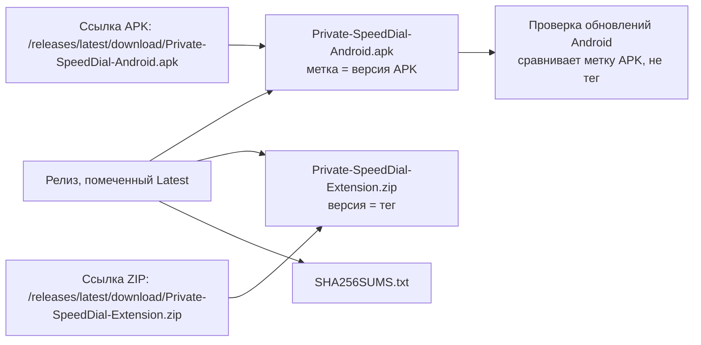

# Правила публикации релизов

Документ фиксирует, что нужно соблюдать при каждом выпуске, чтобы постоянные ссылки
`releases/latest/download/...` не ломались, когда APK и расширение обновляются независимо.

## Короткая схема



## Инварианты

1. **Имена файлов фиксированы.** `Private-SpeedDial-Android.apk`, `Private-SpeedDial-Extension.zip`,
   `SHA256SUMS.txt`. Переименование рвёт постоянные ссылки и уже установленные приложения.
2. **В ссылках нет номера сборки.** Только `https://github.com/rukazax/Private_SpeedDial/releases/latest/download/<имя>`.
   Путь с тегом (`/releases/download/v6.10.3/...`) допустим лишь для исторических ссылок в документации, но не в README и не в приложении.
3. **В релизе, помеченном Latest, обязаны быть оба файла — APK и ZIP.** Если в выпуске обновляется
   только расширение, к новому релизу прикладывается действующий APK из прошлого релиза. Иначе
   `latest/download/Private-SpeedDial-Android.apk` начнёт отдавать 404.
4. **Версия APK живёт в метке файла (asset label), а не в теге релиза.** Метка — `versionName` из
   собранного APK, например `6.10.3`. Проверка обновлений в приложении сравнивает метку с версией
   установленного приложения; без метки используется тег релиза (прежнее поведение).
5. **Опубликованные ассеты не удаляются и не переименовываются.** GitHub не перенаправляет старые
   адреса ассетов между релизами.
6. **Релиз должен быть стабильным:** не черновик и не prerelease, тег вида `vX.Y.Z`. Иначе GitHub
   не считает его `latest`, и все постоянные ссылки начинают вести на предыдущий выпуск.
7. **Адрес ассета канонический:** `https://github.com/rukazax/Private_SpeedDial/releases/download/<тег>/<имя>`.
   Проверка обновлений отклоняет метаданные, где адрес отличается.

## Порядок выпуска

### Обновляется только расширение

```bash
# 1. версия расширения согласована во всех точках
python3 tools/sync-shared.py --check
python3 tests/check-source.py

# 2. сборка ZIP и контрольных сумм
python3 tools/package-release.py

# 3. коммит и тег
git commit -am "release: X.Y.Z"
git tag -a vX.Y.Z -m "Private SpeedDial X.Y.Z"
git push origin main --tags

# 4. релиз: ZIP + действующий APK (метка = его версия) + SHA256SUMS + скриншоты
gh release create vX.Y.Z dist/Private-SpeedDial-Extension.zip \
  dist/Private-SpeedDial-Android-<версия>.apk \
  dist/SHA256SUMS.txt --title "Private SpeedDial X.Y.Z" --notes-file docs/RELEASE-X.Y.Z.md
```

APK берётся из предыдущего релиза и прикладывается с прежней меткой — она и есть источник правды
о версии Android-сборки.

### Обновляется APK

1. Собрать подписанный APK, подпись должна совпадать с предыдущими сборками (иначе обновление не встанет).
2. Поднять версию в `android-app/AndroidManifest.xml` и в `shared/project.js`.
3. Создать релиз с тегом версии; приложить APK **с меткой, равной его versionName**, и актуальный ZIP расширения.
4. Записать SHA-256 в `SHA256SUMS.txt` тем же скриптом.
5. Проверить, что приложение видит обновление: сравнение идёт по метке, поэтому метка обязана быть
   новее установленной версии.

## Проверка после публикации

```bash
# обе постоянные ссылки должны отвечать 200
curl -sIL -o /dev/null -w '%{http_code}  apk\n' \
  https://github.com/rukazax/Private_SpeedDial/releases/latest/download/Private-SpeedDial-Android.apk
curl -sIL -o /dev/null -w '%{http_code}  zip\n' \
  https://github.com/rukazax/Private_SpeedDial/releases/latest/download/Private-SpeedDial-Extension.zip

# latest — ожидаемый тег, у APK заполнена метка
gh release view --json tagName,assets \
  -q '.tagName, (.assets[] | .name + "  label=" + .label)'
```

Если APK в `latest` нет — ссылка уже сломана, даже когда ZIP на месте. Лечится немедленно:
`gh release upload <тег> путь/к/Private-SpeedDial-Android.apk` с меткой версии.

## Границы

- Логика проверки обновлений реализована в `shared/project-updates.js` и попадает в APK только со
  следующей сборкой. Уже установленные версии сравнивают тег релиза — для них действует правило 3,
  а лишнее предложение снимается кнопкой «Пропустить релиз».
- Сборка APK требует ключа подписи проекта; без него выпускается только расширение, а APK
  переносится из предыдущего релиза без изменения метки.
