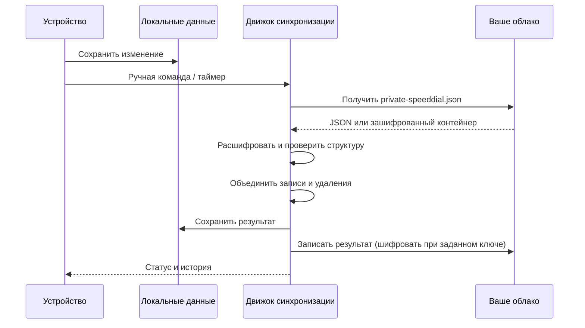

# Синхронизация

## Сервисы

Поддерживаемые адаптеры: WebDAV, Nextcloud, Dropbox, Box (beta), OneDrive, pCloud, Яндекс.Диск, Облако Mail.ru. Доступность API, требования к токенам и ограничения зависят от сервиса. Приложение не создаёт аккаунты и OAuth-приложения провайдеров за пользователя.

| Провайдер | Что указать в настройках |
|---|---|
| WebDAV / Synology | URL каталога WebDAV, логин, пароль с правами чтения/записи |
| Nextcloud | URL WebDAV каталога, логин, при необходимости пароль приложения |
| Dropbox | Access token и папку |
| Box (beta) | Access token; ID существующего файла при необходимости |
| OneDrive | Access token и папку |
| pCloud | Access token и папку |
| Яндекс.Диск | OAuth-токен и папку |
| Mail.ru | Email, пароль/доступ приложения, путь папки в соответствии с поддерживаемым API |

Для WebDAV используйте HTTPS и действующий сертификат. Незашифрованный HTTP технически разрешён для совместимости с локальными серверами: он не защищает реквизиты и содержимое от наблюдения в сети. Проверка TLS в HTTPS не отключается. Не вставляйте реквизиты в сам URL и не отправляйте их разработчику.

## Первое подключение

1. Экспортируйте локальные данные в JSON как резервную копию.
2. На одном устройстве настройте провайдер, нажмите проверку соединения.
3. При необходимости задайте **ключ шифрования**. Сохраните его отдельно: восстановить его по зашифрованному файлу нельзя.
4. Выберите загрузку на сервер для исходного заполненного устройства либо объединение, если данные есть с обеих сторон.
5. На втором устройстве укажите тот же сервис, каталог и ключ. При первом соединении используйте скачивание или объединение.
6. Измените тестовую закладку на одном устройстве, синхронизируйте оба и убедитесь, что изменение пришло. Затем удалите тестовую запись и повторите проверку.

## Режимы

- **Объединение**: совмещает данные, учитывая идентификаторы, время изменения и маркеры удаления.
- **Загрузить на сервер**: публикует локальный набор в выбранное хранилище. Резервная копия особенно важна.
- **Скачать с сервера**: получает удалённый набор. Сохраните экспорт локальных данных заранее.

Второй провайдер можно настроить для параллельной синхронизации; его выбор, как и основной провайдер и реквизиты, остаётся локальным. Состояние проверки обновлений и список пропущенных версий тоже не синхронизируются.

## Что защищено и что остаётся локальным

При заданном ключе файл данных защищается AES-GCM; ключ выводится с использованием PBKDF2. Без ключа файл — обычный JSON. Передача HTTPS и шифрование файла решают разные задачи и могут использоваться вместе. Реквизиты провайдеров, ключ шифрования и выбор серверов исключены из синхронизируемых настроек.

На Android локальная SQLite и SharedPreferences находятся в приватном каталоге приложения, но дополнительного шифрования базы самим приложением нет. Удаление приложения удаляет локальные данные. Облачный файл и ручные экспорты не являются частью отключённого Android Auto Backup.

## Ограничения и диагностика

Автосинхронизация Android работает, пока приложение открыто; постоянной фоновой службы и гарантированных задач после закрытия нет. Токены могут истекать, сервисы менять API и ограничивать частоту запросов. При ошибке проверьте журнал в настройках, доступность каталога и ключ. Перед публикацией журнала удалите личные адреса и идентификаторы.

Тестовые проверки этой версии используют локальный WebDAV и имитацию API других провайдеров. Это проверяет обработку протокола, ошибок и данных, но не подтверждает вход в реальные аккаунты всех сервисов. Для выбранного вами провайдера выполните реальный цикл из шага 6.
