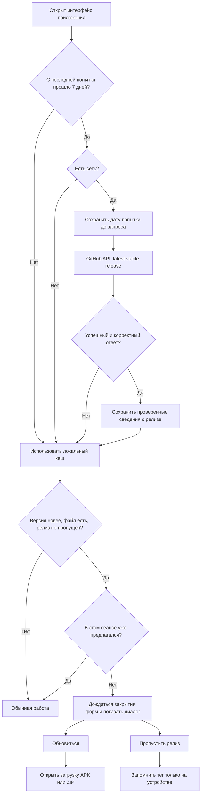

# Проверка обновлений и выпуск релизов

## Клиентский алгоритм

Источник — `GET https://api.github.com/repos/rukazax/Private_SpeedDial/releases/latest`, без авторизации и передачи пользовательских данных. Используются JSON API GitHub и заголовок версии API `2026-03-10`. Поведение latest: [официальная документация GitHub](https://docs.github.com/en/rest/releases/releases#get-the-latest-release).

Недельный интервал — 604 800 000 мс. Параллельные вызовы в одном worker/фоновом контексте объединяются. Дата сохраняется до сети, поэтому 404, 429, тайм-аут, неверный JSON и перезапуск не вызывают немедленный повтор. При явном отсутствии сети запрос не выполняется; онлайн-попытка остаётся доступна. Перевод системных часов назад не снимает интервал. При недоступности GitHub обычная работа продолжается.

Успешный ответ должен описывать стабильный релиз этого репозитория с тегом `vX.Y.Z` или `X.Y.Z`. Версии сравниваются численно по трём компонентам. Отсеиваются текущая/старая версия, prerelease, draft, сторонние ссылки и отсутствующий/не загруженный файл нужной платформы. Ответ не вставляется как HTML. В локальном кеше также проверяются адреса перед использованием.

Состояние `projectUpdateState` хранится в `chrome.storage.local` / приватных SharedPreferences Android; оно не входит в облачный payload. `skippedTag` исключает конкретную версию. Захват предложения через `storage.session` предотвращает несколько одинаковых диалогов в одном сеансе. Закрытие окна кликом мимо или «Назад» не означает постоянного пропуска. При новом сеансе доступное обновление снова может быть предложено.

API запрашивается только при открытом интерфейсе, когда подошёл срок. Это не фоновая задача, которая обязательно запустится ровно через неделю. Принудительной кнопки обхода недельного ограничения нет. Ссылка «Скачать приложения» позволяет пользователю самостоятельно открыть GitHub в любое время.

## Контракт релиза

Стабильный выпуск публикуется в `rukazax/Private_SpeedDial`, тег текущего выпуска — `v6.10.0`. Обязательные файлы:

| Имя | Назначение |
|---|---|
| `Private-SpeedDial-Android.apk` | Официальная подписанная release APK |
| `Private-SpeedDial-Extension.zip` | Распаковываемое расширение, manifest.json в корне архива |
| `SHA256SUMS.txt` | SHA-256 загруженных артефактов |
| `Private-SpeedDial-Source.zip` | Исходники текущего Git-коммита без ключей и сборочного мусора |

Стабильные ссылки для пользователей:

- [Android APK](https://github.com/rukazax/Private_SpeedDial/releases/latest/download/Private-SpeedDial-Android.apk)
- [Расширение ZIP](https://github.com/rukazax/Private_SpeedDial/releases/latest/download/Private-SpeedDial-Extension.zip)
- [Контрольные суммы](https://github.com/rukazax/Private_SpeedDial/releases/latest/download/SHA256SUMS.txt)

## Процедура следующего выпуска

1. Изменить версию в `shared/project.js`, манифесте расширения, `android-app/AndroidManifest.xml`, Android `bridge.js` и проверках версии. Для Android увеличить versionCode. Обновить CHANGELOG и инструкции.
2. Выполнить `python3 tools/sync-shared.py`, проверки исходников, unit-тесты, проверки интерфейсов и release APK по [инструкции сборки](BUILD.md).
3. Собрать release APK без `--debug-webview`, проверить прежнюю подпись. Запустить `python3 tools/package-release.py`.
4. Закоммитить исходники и документацию, отправить в GitHub. Исходный ZIP получить из этого коммита командой `git archive`, как в инструкции сборки.
5. Создать **черновик** релиза с точным тегом `vX.Y.Z`, загрузить APK, ZIP расширения, исходники и SHA256SUMS. Проверить файлы и суммы, затем опубликовать стабильный релиз. Не помечать его prerelease.
6. Проверить API latest, теги, все download URL и содержимое скачанных файлов. На ранее установленной версии проверить предложение обновления, скачивание и установку поверх старой версии с сохранением данных.

Не изменяйте APK или ZIP уже опубликованного тега на другой код: выпустите новый тег/номер. Не публикуйте отладочную сборку и ключ подписи. Пропущенный пользователем тег не будет повторно предлагаться, даже если вы замените его файлы.
